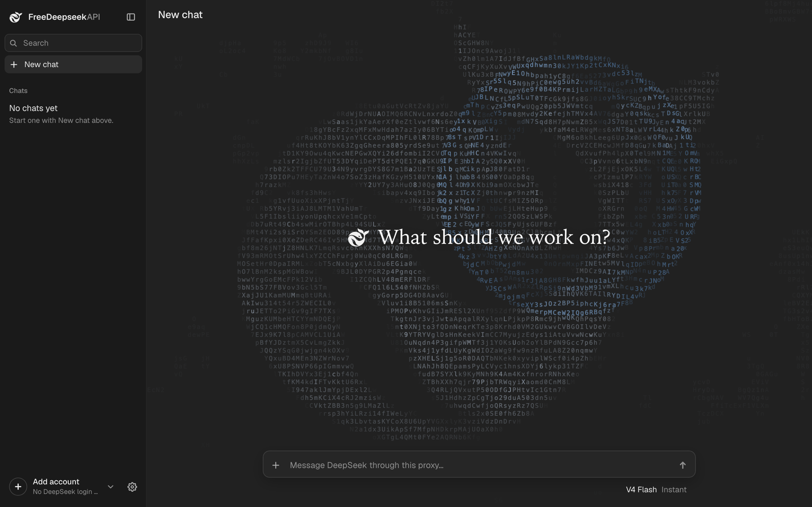
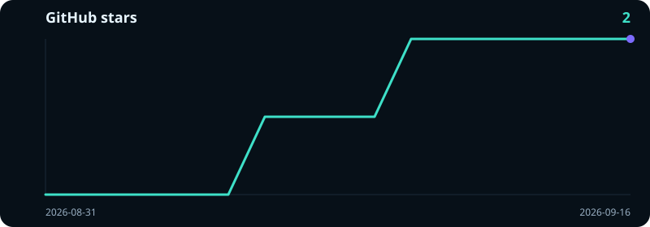

<p align="center">
  
</p>

<h1 align="center">FreeDeepseekAPI</h1>

<p align="center">
  <strong>Ваш бесплатный аккаунт DeepSeek как API</strong>
</p>

<p align="center">
  <a href="https://github.com/dekrezz/FreeDeepseekAPI/blob/main/LICENSE"></a>
  
  
  
</p>

<p align="center">
  <a href="README.md">English</a> ·
  <strong>Русский</strong> ·
  <a href="README.zh.md">简体中文</a>
</p>

<p align="center">
  
</p>

FreeDeepseekAPI работает на вашем компьютере и превращает бесплатный аккаунт [chat.deepseek.com](https://chat.deepseek.com) в локальный API. Через него с DeepSeek может говорить любое приложение, которое умеет работать с OpenAI или Anthropic: Open WebUI, Claude Code, Codex, Cursor и другие. Платный ключ не нужен.

## Как начать

Нужны [Node.js](https://nodejs.org) 18 или новее, Git, Google Chrome и аккаунт DeepSeek.

```bash
git clone --branch stable https://github.com/dekrezz/FreeDeepseekAPI.git
cd FreeDeepseekAPI
npm run auth
npm run dashboard
```

1. `npm run auth` откроет Chrome. Выберите **Sign in with Chrome**, войдите в DeepSeek, отправьте короткое сообщение, например `ok`, и вернитесь в терминал.
2. `npm run dashboard` запустит прокси и откроет дашборд. Писать в чат можно прямо там.

## Как подключить приложение

Впишите в настройках приложения:

| Настройка | Значение |
|---|---|
| Base URL | `http://127.0.0.1:9655/v1` |
| API key | любой текст |
| Модель | `deepseek-v4-flash` |

Для Open WebUI в Docker адрес другой: `http://host.docker.internal:9655/v1`.

## Как настроить агентов

Не останавливайте прокси и выполните:

```bash
npm run setup:agents
```

Команда добавит DeepSeek в Claude Code, Codex, OpenCode, Hermes, OpenClaw и Cursor как дополнительный вариант. Ваши текущие настройки останутся, а шаг можно пропустить прямо в мастере. То же самое есть в дашборде: Settings → Agents.

## Частые вопросы

**Это правда бесплатно?**
Да. Используется тот же бесплатный аккаунт, что и на сайте DeepSeek.

**Это официальный проект DeepSeek?**
Нет. Он работает с закрытым веб-чатом DeepSeek, а тот может измениться в любой момент. Когда это случается, проект обновляется вслед за ним.

**Могут ли забанить аккаунт?**
Могут. DeepSeek способен заблокировать логин на несколько дней, если два чата отправляют с него сообщения одновременно. Поэтому прокси держит один чат на логин, а следующий ждёт очереди. Риск от этого ниже, но полностью он не исчезает: правила задаёт DeepSeek.

**Куда уходят мой логин и сообщения?**
Логин остаётся на вашем компьютере в `deepseek-auth.json`. Сообщения уходят в DeepSeek, как и в обычном чате.

**Какую модель выбрать?**
Модель одна, у неё два переключателя:

| Модель | Что делает |
|---|---|
| `deepseek-v4-flash` | Отвечает с поиском в интернете |
| `deepseek-v4-flash-thinking` | Сначала думает, потом отвечает |

Чтобы отключить поиск, допишите к любой из них `-nosearch`.

**Можно несколько аккаунтов?**
Да. Добавьте их в дашборде: Settings → Accounts. Чтобы два агента работали одновременно, нужно два логина.

**Перестало работать. Что делать?**
Попробуйте по порядку:
1. Обновитесь: Settings → Updates в дашборде.
2. Войдите заново: `npm run auth`.
3. Проверьте настройку: `npm run doctor`.

Если не помогло, скорее всего, DeepSeek что-то изменил. [Напишите нам в issue](https://github.com/dekrezz/FreeDeepseekAPI/issues).

**Как обновиться?**
Откройте Settings → Updates в дашборде и нажмите **Check for updates**. На канал `stable` релиз приходит после проверки, на `latest` сразу.

**Можно подключаться с других устройств?**
По умолчанию доступ есть только с вашего компьютера. Чтобы открыть его, задайте `PROXY_API_KEY` и сначала прочитайте раздел [Running it safely](SECURITY.md#running-it-safely).

**Работает на Windows, сервере или в контейнере?**
Да: [Windows](docs/ru/guide.md#windows), [VPS](docs/ru/guide.md#vps--headless), [Podman](docs/ru/guide.md#rootless-podman).

## Что ещё почитать

- [Полное руководство](docs/ru/guide.md): всё подробно, с примерами запросов
- [HTTP API](docs/api.md): эндпоинты, ошибки и настройки (на английском)
- [Модели](docs/ru/models.md) · [Аккаунты и вход](docs/ru/auth.md) · [Агенты](docs/ru/agents.md)
- [Безопасность](SECURITY.md): как сообщить об уязвимости

## Звёзды

<a href="https://github.com/dekrezz/FreeDeepseekAPI/stargazers">
  
</a>

## Лицензия

Apache-2.0. Copyright 2026 dekrezz.
