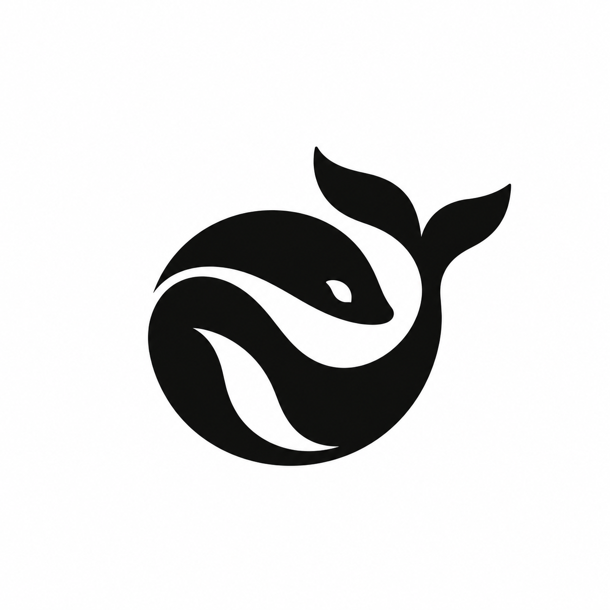
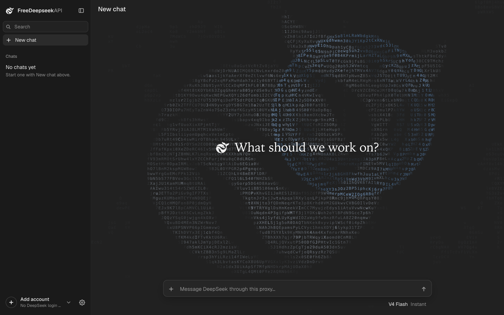
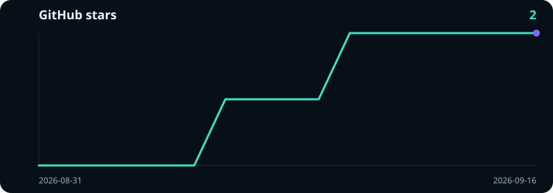

<p align="center">
  
</p>

<h1 align="center">FreeDeepseekAPI</h1>

<p align="center">
  <strong>把免费的 DeepSeek 账号变成 API</strong>
</p>

<p align="center">
  <a href="https://github.com/dekrezz/FreeDeepseekAPI/blob/main/LICENSE"></a>
  
  
  
</p>

<p align="center">
  <a href="README.md">English</a> ·
  <a href="README.ru.md">Русский</a> ·
  <strong>简体中文</strong>
</p>

<p align="center">
  
</p>

FreeDeepseekAPI 运行在你的电脑上，把免费的 [chat.deepseek.com](https://chat.deepseek.com) 账号变成本地 API。凡是支持 OpenAI 或 Anthropic 的应用，都能通过它使用 DeepSeek，比如 Open WebUI、Claude Code、Codex、Cursor。不需要付费密钥。

## 快速上手

需要 [Node.js](https://nodejs.org) 18 或更高版本、Git、Google Chrome 和一个 DeepSeek 账号。

```bash
git clone --branch stable https://github.com/dekrezz/FreeDeepseekAPI.git
cd FreeDeepseekAPI
npm run auth
npm run dashboard
```

1. `npm run auth` 会打开 Chrome。选择 **Sign in with Chrome**，登录 DeepSeek，发一条简短的消息（比如 `ok`），然后回到终端。
2. `npm run dashboard` 会启动代理并打开控制台，可以直接在里面聊天。

## 连接应用

在应用的设置里填写：

| 设置 | 值 |
|---|---|
| Base URL | `http://127.0.0.1:9655/v1` |
| API key | 任意文字 |
| 模型 | `deepseek-v4-flash` |

在 Docker 里运行的 Open WebUI 要改用 `http://host.docker.internal:9655/v1`。

## 配置编程代理

保持代理运行，然后执行：

```bash
npm run setup:agents
```

它会把 DeepSeek 作为额外选项加到 Claude Code、Codex、OpenCode、Hermes、OpenClaw 和 Cursor 中。你现有的设置不变，也可以在向导里跳过这一步。控制台里同样可以操作：Settings → Agents。

## 常见问题

**真的免费吗？**
是的。用的就是你在 DeepSeek 网站上的免费账号。

**这是 DeepSeek 官方项目吗？**
不是。它对接的是 DeepSeek 不公开的网页聊天接口，这个接口随时可能变化。变化之后，项目会跟着更新。

**账号会被封吗？**
有可能。如果同一个登录同时有两个聊天在发送，DeepSeek 可能封禁它几天。所以代理让每个登录同一时间只跑一个聊天，其余的排队。这样风险更低，但无法完全消除，规则由 DeepSeek 决定。

**我的登录信息和消息会去哪里？**
登录信息保存在你电脑上的 `deepseek-auth.json` 里。消息会发给 DeepSeek，和普通聊天一样。

**该选哪个模型？**
只有一个模型，两个开关：

| 模型 | 作用 |
|---|---|
| `deepseek-v4-flash` | 联网搜索后回答 |
| `deepseek-v4-flash-thinking` | 先思考，再回答 |

在任意一个后面加上 `-nosearch` 就会关闭联网搜索。

**可以用多个账号吗？**
可以。在控制台的 Settings → Accounts 里添加。两个代理同时工作需要两个登录。

**突然用不了了怎么办？**
按顺序试试：
1. 更新：控制台的 Settings → Updates。
2. 重新登录：`npm run auth`。
3. 检查配置：`npm run doctor`。

还不行的话，多半是 DeepSeek 改了什么。请[提交 issue](https://github.com/dekrezz/FreeDeepseekAPI/issues)。

**怎么更新？**
打开控制台的 Settings → Updates，点 **Check for updates**。`stable` 渠道的版本经过检查后才发布，`latest` 渠道最先收到每个版本。

**其他设备能用吗？**
默认只有你的电脑能访问。要共享的话，请设置 `PROXY_API_KEY`，并先阅读 [Running it safely](SECURITY.md#running-it-safely)。

**支持 Windows、服务器或容器吗？**
支持：[Windows](docs/zh/guide.md#windows)、[VPS](docs/zh/guide.md#vps--无界面)、[Podman](docs/zh/guide.md#rootless-podman)。

## 更多内容

- [完整指南](docs/zh/guide.md)：详细说明和请求示例
- [HTTP API](docs/api.md)：接口、错误和设置（英文）
- [模型](docs/zh/models.md) · [账号与登录](docs/zh/auth.md) · [编程代理](docs/zh/agents.md)
- [安全](SECURITY.md)：如何报告漏洞

## Star

<a href="https://github.com/dekrezz/FreeDeepseekAPI/stargazers">
  
</a>

## 许可证

Apache-2.0. Copyright 2026 dekrezz.
